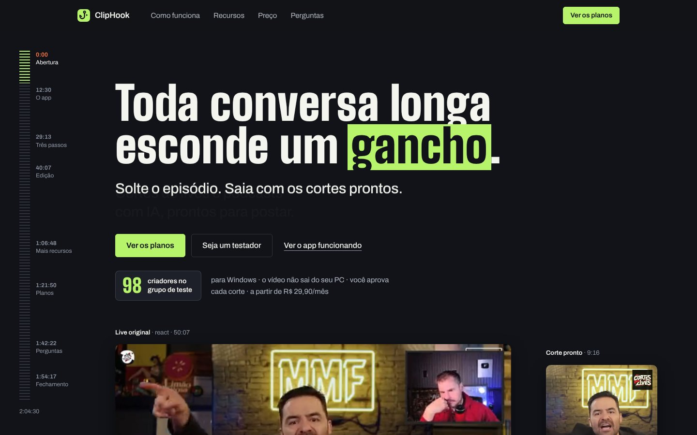

# Site do ClipHook

**[cliphook.com.br](https://cliphook.com.br)**

Site de venda do [ClipHook](https://cliphook.com.br), um programa para Windows que usa IA para transformar lives, podcasts e vídeos longos em cortes verticais legendados. Produto, marca, design e código por [Ricardo Chiarini](https://ricardochiarini.com).

Este repositório guarda o site já montado, do jeito que vai ao ar. O GitHub Pages publica o conteúdo da branch `main` no domínio do arquivo `CNAME`.

## Páginas

| Página | Arquivo |
|---|---|
| Início | `index.html` |
| Como funciona, recursos, preço e perguntas | `como-funciona.html`, `recursos.html`, `preco.html`, `perguntas.html` |
| Comparação com outras ferramentas | `comparar.html` |
| Páginas por uso | `cortes-de-lives.html`, `cortes-de-podcast.html`, `cortes-para-shorts-reels-e-tiktok.html` |
| Guias | `guias.html` e `guia-*.html` |
| Assinatura e download | `assinar.html`, `baixar.html` |
| Termos e privacidade | `termos.html`, `privacidade.html` |

## Decisões

- **HTML e CSS estáticos, sem framework.** Cada página chega pronta, com o CSS da marca embutido. O pouco de JavaScript que existe fica dentro da própria página.
- **Nada carregado de fora.** Fontes, imagens e vídeos são servidos pelo próprio site, e a política de segurança de conteúdo (CSP) só permite o próprio domínio.
- **Demonstração com vídeo real.** A pasta `demo/` tem trechos curtos de uma live e o corte vertical que o app gerou a partir deles.
- **SEO técnico.** Título, descrição, Open Graph, endereço canônico e `sitemap.xml` em todas as páginas; guias escritos para quem procura como fazer cortes.

## Licença

Código aberto para leitura, como portfólio. Todos os direitos reservados: veja [LICENSE](LICENSE). As fontes Archivo e Big Shoulders seguem a SIL Open Font License (`fonts/OFL-*.txt`).
